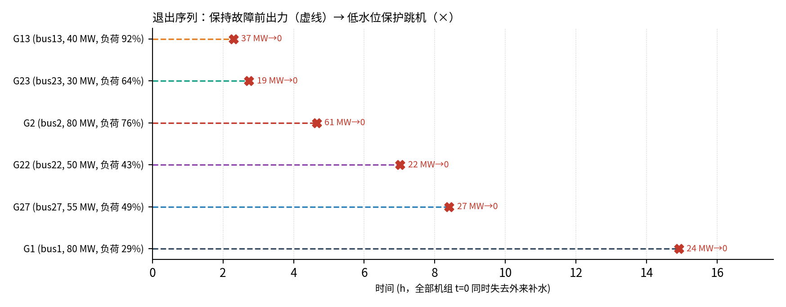
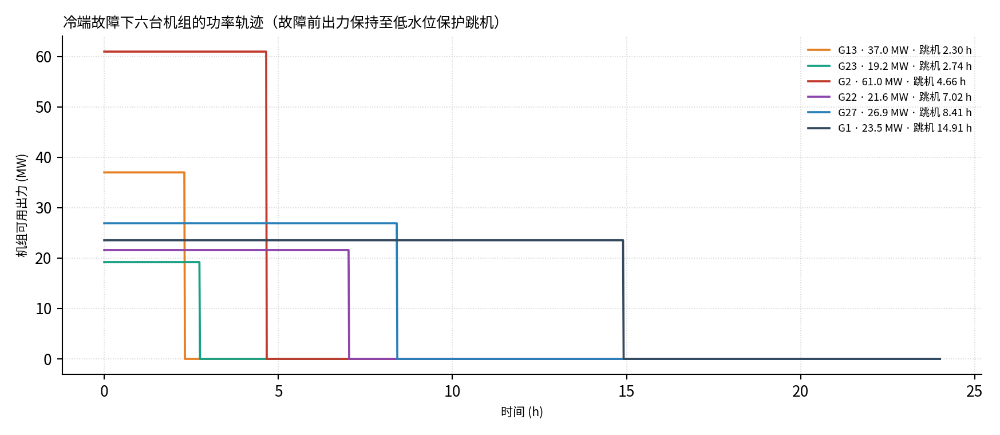
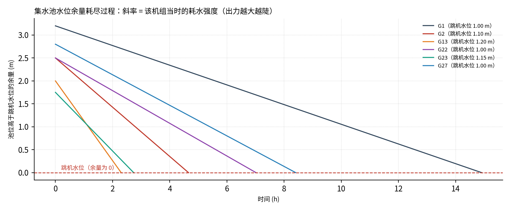

# 冷却水系统机理、六机组基准与单机补水中断—电网动态耦合

> 用途：保留六台机组独立冷却水系统的固定故障前出力基准，并建立单机补水中断的跨域主线：
> 指定机组冷端耗尽 → 低水位保护跳机 → IEEE 30 电网级联/动态再调度 → 按实际出力更新其他机组冷端需水 → 后续保护退出反馈。
> G13 原有动态结果继续保留；G1、G2、G22、G23、G27 各自作为独立故障情景，不与 G13 结果覆盖或串联。
>
> 代码：`src/coldend/`、`src/cascade.py`　参数：`data/coldend/unit_anchors.csv`
> 基准结果：`results/IEEE30/P5_coldend/`　G13 原结果：`results/IEEE30/P6_coupled_G13/`
> 新五场景：`results/IEEE30/P6_coupled_single_unit/`

---

## 0. 一句话结论

冷端把"机组退出"从**瞬时集合**变为**按小时排序的事件序列**。六机组固定出力基准在补水中断后不隔离排污、
保持故障前出力至低水位保护跳机，顺序为 **G13 → G23 → G2 → G22 → G27 → G1**（2.30–14.91 h）。
单机动态耦合覆盖六个互相独立的初始事件（G13 既有基准及新增 G1、G2、G22、G23、G27）。新增五案中 G22/G27 的旧复合指标分别为 10/30、4/30，但均为 F1 电压越限；按最终硬失供判据 `F3 ∨ F2b`，五案硬失供均为 0。F1 不再触发停止，五案冷端轨迹均完整跟踪 24 h；参考假设下没有二次冷端跳机。各机组触发、频率、爬坡缺额、F1/F2/F3 与硬失供结果汇总于 `P6_coupled_single_unit/README.md`。爬坡率和补水能力为非现场实测假设，高负荷倍率不作为本主线参数。

---

## 1. 模型来源与等价性

`src/coldend/model.py` 与上传的 `coldend_makeup_interrupt.py` **逐位等价**（sha256 相同，
物理、数值格式、判据顺序均未改动），仅作为被调用的引擎：

| 层次 | 内容 |
|---|---|
| 机组模板 | 500 MW 湿冷原型 `Params()` 默认值 |
| 容量缩放 | `s = Pmax/500`，循环水量 `qcw`、池面积 `A` 按 `s` 线性缩放 |
| 机组锚点 | `data/coldend/unit_anchors.csv` 逐项覆盖（唯一事实来源） |

上传文件自带的等价性证据（`python3 src/coldend/model.py --self-check` 可复现）：
18 行 S1a（τ_cond × τ_tower 矩阵）逐位一致；dt=0.25/1/0.1 s 步长差 0.014 MWh（0.0005%）；
区间能量残差 ~1e-11 MJ。**迁移到本工作区后未改一行物理代码，因此这些证据继续成立。**

机组群主情景不直接使用引擎默认运行策略：`units.py` 固定覆盖 `blowdown_isolated_on_detection=False`、
`ride_down=False`。这关闭排污隔离与水位触发降负荷，只改变情景开关，不改物理函数。原引擎保留默认项是为了保持上传文件自检可复现。

---

## 2. 机理：从补水中断到跳机

### 2.1 状态与因果链

模型是**串行因果**的定步长推进（dt=1 s），每个时间步按固定顺序更新，不允许回路内迭代：

```
池水位 V/h ──► 循泵可用流量 x ──► 塔出口水温 Tin ──► 凝汽器 T_sat / 背压 pb
     ▲                                                        │
     │                                                        ▼
  耗水率 E+B+D ◄── 排热量 Q ◄── 汽轮机功率 P ◄── 背压修正（本算例未触发降额）
```

关键点：**水位是唯一的"库存"**，其余都是代数或一阶滞后环节。所以"多久之后影响电网"
基本由水位库存与耗水率的比值决定，其余参数只做修正。

### 2.2 水侧库存（慢，小时级）

$$V(t)=A\,h(t),\qquad \frac{dV}{dt}=-(E+B+D)$$

- 蒸发 $E = 0.82\,Q/(\rho L)$，$L\approx 2.4\times10^6$ J/kg，$Q$ 为凝汽器排热（≈ 出力 / 效率 − 出力）
- 排污按浓缩倍数盐平衡：$S=B+D=E/(CoC-1)$
- 飘滴 $D=5\times10^{-5}q_{cw}$，比前两项小两个量级
- 补水中断 ⇒ 补水项为 0；**本主情景不隔离排污**，只要机组仍运行，排污按当前热负荷与 CoC 正常计算；机组跳机后耗水归零。
- 因此“检测延时”不再是本情景参数：没有排污隔离动作，就没有对应的确认/动作时刻。

跳机条件由此给出解析骨架：

$$t_{\text{drain}}\approx\frac{A\,(h_{norm}-h_{trip})}{\dot m_{makeup}}\cdot 3600^{-1}\ \text{[h]}$$

### 2.3 循环水泵（中，秒—分钟级）

泵流量分数取扬程平衡与汽蚀两个约束的较小者：

$$x_{hyd}=\sqrt{\frac{H_{shutoff}-H_{static}(h)}{H_{shutoff}-H_{static,d}}},\qquad
x_{npsh}=\min\left(1,\ \frac{NPSH_a(h,T_{in})}{NPSH_r\,x_{hyd}^2+\Delta_{margin}}\right)$$

$NPSH_a$ 随水位线性下降、随水温（饱和蒸气压）下降，因此**水位低 + 水温高 ⇒ 泵先失流**。
流量按 τ_pump=10 s 一阶滞后，塔/凝汽器分别按 τ_tower=200–360 s、τ_cond=80–150 s 滞后。

### 2.4 冷却塔与凝汽器（中，分钟级）

- 塔按 effectiveness–NTU 降阶：$\varepsilon=1-e^{-NTU}$，$NTU$ 随气水比按 0.45 次幂变化；
  出口水温 $T_{in}=T_{wb}+\Delta T_{range}(1-\varepsilon)/\varepsilon$
- 凝汽器用 UA–LMTD 的集总等价写法 + 蓄热一阶：$C\,dT_{sat}/dt=\dot Q_{steam}-\dot Q_{water}$，
  其中 $\dot Q_{water}=G(T_{sat}-T_{in})$，$G=\dot m c_p(1-e^{-UA/\dot mc_p})$，$UA\propto x^{0.8}$（清洁度可乘）
- 背压由 $T_{sat}$ 经 Magnus 饱和线给出：**流量降 → 端差涨 → $T_{sat}$ 涨 → 背压涨 → 出力降**

### 2.5 功率与保护（快，秒级）

背压可以修正汽轮机可用出力，但本算例在低水位跳机前没有触及低真空定值，故不产生背压降额。
主线不设置水位触发的人工降负荷（SOP）。机组从故障前出力运行至保护动作，出力在跳机时一次归零。
这样做是针对当前电网模型接口的简化：`CascadeSim.run_scenario()` 接收的是发电机跳机母线集合，
不接收连续 $P_i(t)$ 降负荷轨迹或跳机前出力。

保护判据顺序仍由原机理内核固定：**① 低水位 → ② 泵汽蚀下限 → ③ 低真空（含 3 s 延时）→ ④ 技术最小出力**；
本算例六台机组均由低水位先触发。

### 2.6 三个时间尺度（为什么叫"慢动态"）

| 尺度 | 环节 | 量级 | 对电网的意义 |
|---|---|---|---|
| 慢 | 池位库存 | 小时（本主情景跳机 2.30–14.91 h） | 决定**何时**退出、**顺序** |
| 中 | 塔/凝汽器/泵惯性 | 80–360 s | 决定冷端温度、背压的响应速度 |
| 快 | 保护、跳机 | 秒 | 决定退出是**阶跃**而不是斜坡 |

仿真中观察到的形态是：**小时级潜伏期，随后低水位保护动作，机组出力阶跃归零**。
主线不包含人工降负荷斜坡。

---

## 3. 为什么"级联到电网的时间"会因机组而异

由 $t\approx A(h_{norm}-h_{trip})/\dot m_{makeup}$，主导因子只有两类：

| 因子 | 方向 | 说明 |
|---|---|---|
| 当时出力 $P_0$ | ↑ ⇒ 更快 | 排热 $\propto P$，蒸发和正常排污增加；**注意是出力而不是容量** |
| 负荷率 $P_0/P_{max}$ | ↑ ⇒ 更快 | 按故障前运行点计算 |
| 可用池容 $A(h_{norm}-h_{trip})$ | ↑ ⇒ 更慢 | 池面积、正常水位、跳机水位 |
| 浓缩倍数 CoC | ↑ ⇒ 更慢 | 排污 $\propto 1/(CoC-1)$；不隔离排污时，CoC 全程影响耗水 |
| 检测延时 | 不适用 | 不隔离排污，没有排污隔离动作与相应检测延时 |
| SOP / 技术最小 / 降负荷速率 | 主线不建模 | 电网级联接口不读取降负荷轨迹；这些参数不影响当前母线失效计算 |
| 塔逼近度 / 清洁度 | 本组参数下时刻影响小 | 主要改变背压；本算例仍由低水位保护先动作 |

对本算例，**出力/池容之比解释了几乎全部排序**：G13 负荷率 92.5%、可用池容只有 218 m³；
G1 负荷率 29%、池容 983 m³，两者相差 20 倍的时间尺度。

---

## 4. 每台机组一套冷却水系统

### 4.1 设计原则

1. **结构相同、参数不同**：都按"机械通风湿冷塔 + 集水池 + 循环泵 + 表面式凝汽器"建模，
   机组间差异体现在池容、水位定值、CoC、塔与凝汽器状态、保护与运行规程。
2. **可溯源**：逐项写 `basis`，说明凭什么这么取。
3. **可替换**：换机组/换场站只改 `data/coldend/unit_anchors.csv`，不动代码。
4. **不冒充实测**：除 `pg0_mw`（case30 的 Pg）、`pmax_mw`（case30 的 Pmax）外，
   全部为参考模板/工程假设，标注 `reference_template_not_site_measured`。

### 4.2 六台机组的差异配置（`unit_anchors.csv` 摘要）

| 机组 | bus | Pmax | P0 | 负荷率 | 系统配置 | 池面积 | 水位 正常/跳机 | CoC | 塔逼近度 | 清洁度 |
|---|---:|---:|---:|---:|---|---:|---|---:|---:|---:|
| G1 | 1 | 80 | 23.54 | 29.4% | 2×50% 泵 + 混凝土池 | 307 m² | 4.20/1.00 m | 4.5 | 6.0 K | 0.94 |
| G2 | 2 | 80 | 60.97 | 76.2% | 2×50% 泵 + 混凝土池 | 282 m² | 3.60/1.10 m | 4.0 | 5.0 K | 0.95 |
| G13 | 13 | 40 | 37.00 | 92.5% | 1×100% 泵 + 钢池 | 109 m² | 3.20/1.20 m | 3.5 | 5.5 K | 0.92 |
| G22 | 22 | 50 | 21.59 | 43.2% | 1×100% 泵 + 混凝土池 | 160 m² | 3.50/1.00 m | 4.5 | 5.8 K | 0.88 |
| G23 | 23 | 30 | 19.20 | 64.0% | 1×100% 泵 + 钢池 | 86 m² | 2.90/1.15 m | 3.0 | 7.0 K | 0.90 |
| G27 | 27 | 55 | 26.91 | 48.9% | 2×50% 泵 + 混凝土池 | 202 m² | 3.80/1.00 m | 5.0 | 4.5 K | 1.00 |

逐台理由（完整版见 CSV 的 `basis` 列）：

- **G1**：80 MW 级机组当前只带 29% 负荷；池面积取线性缩放的 1.2 倍、正常水位 4.20 m，
  塔填料老化（逼近度 6.0 K）。→ 当前负荷低、可用池容大 ⇒ **最后退出**。
- **G2**：系统主力机组（76% 负荷），凝汽器较清洁（0.95）。
  → 绝对耗水量最大（151 m³/h）⇒ 约 4.9 h 退出。
- **G13**：40 MW 级机组带 92.5% 负荷，厂址紧凑（池面积系数 0.85）、CoC 较低（3.5，
  正常补水约 95 m³/h）。→ 静态库存/耗水估计约 2.13 h，动态仿真在 2.30 h 跳机（六台中最早）。
- **G22**：50 MW 级（43% 负荷），凝汽器结垢（清洁度 0.88、逼近度 5.8 K）。
  → 中后段约 7.04 h 退出；本组参数下结垢主要改变背压，不改变由池水位主导的退出机制。
- **G23**：30 MW 级老旧小机组（64% 负荷），塔填料劣化（逼近度 7.0 K）、CoC 3.0、
  水位裕度较小（正常水位 2.90 m）。→ 与 G13 为最先退出的两台。
- **G27**：55 MW 级较新机组（49% 负荷），塔与凝汽器状态最好（4.5 K、清洁度 1.00）、
  CoC 5.0（补水最省 67 m³/h）、池容裕度最大（1.15 倍）。
  → 倒数第二退出。

### 4.3 各机组故障前的冷端工况（`unit_parameters.csv` 摘要）

| 机组 | 循环水量 m³/s | 排热 MW_th | 蒸发 m³/h | 排污 m³/h | 补水 m³/h | 背压 kPa | 端差 K | 备份池容 m³ |
|---|---:|---:|---:|---:|---:|---:|---:|---:|
| G1 | 2.52 | 42.4 | 51.3 | 14.2 | 65.9 | 3.47 | 1.39 | 983 |
| G2 | 2.52 | 93.6 | 113.5 | 37.4 | 151.3 | 5.88 | 3.00 | 704 |
| G13 | 1.26 | 55.7 | 67.6 | 26.8 | 94.7 | 7.56 | 3.79 | 218 |
| G22 | 1.58 | 36.6 | 44.3 | 12.4 | 57.0 | 4.38 | 2.16 | 400 |
| G23 | 0.95 | 30.3 | 36.8 | 18.3 | 55.3 | 6.20 | 2.86 | 151 |
| G27 | 1.74 | 44.6 | 53.9 | 13.2 | 67.4 | 4.01 | 1.89 | 567 |

六台机组合计出力 189.2 MW，即算例的全部发电（全网负荷约 189 MW）；此前"G2+G13 双机退出"
场景造成的 189 MW 减载，正是这两台机组退出后全网失负荷、与总发电量相等的结果。

### 4.4 简化策略与参数裁剪

| 项目 | 主情景设定 | 是否保留为机组参数 |
|---|---|---|
| CoC | 按盐平衡持续计算正常排污 | 保留；直接影响耗水与跳机时刻 |
| 排污隔离 | 关闭；机组运行时排污，跳机后耗水归零 | 固定场景开关，不逐机设定 |
| 检测延时 | 无隔离动作，无对应检测/执行时刻 | 移出锚点和结果 |
| SOP 降负荷 | 不建模；保持故障前出力至跳机 | 移除逐机设置 |
| 技术最小、降负荷速率 | 主要服务于水位触发的降负荷；本算例低水位先触发且背压未降额 | 从机组锚点中移除；引擎保留默认值，当前主线结果不受其影响 |

**为什么删除 SOP**：当前 IEEE 30 `CascadeSim.run_scenario()` 只接收 `gen_trip` 机组集合，
不消费 `fleet_power_profile.csv` 中的连续降负荷曲线，也不使用跳机前出力。因此在本主线接口下，
SOP 只会把跳机时刻移动少量分钟；只要退出次序不变，级联计算的每个累计跳机集合就完全相同。
本算例 SOP 开/关对照的退出次序相同，最大跳机时刻差约 0.262 h；故为减少无效参数，主线固定为不降负荷。

---

## 5. 代码结构

```
src/cases.py               IEEE30 唯一算例与备用配置
src/coldend/
  model.py    冷端机理引擎（= 上传文件，sha256 相同，物理未改）
  units.py    每台机组一套系统的装配（读 CSV → Params → 可运行的 Unit 对象）
  fleet.py    六机组同时失去补水的固定 P0 基准 → 退出序列 / 事件流
  coupled.py  单机补水中断 → 频率/爬坡再调度 → 冷端时域推进 → 二次跳机反馈/母线级联
  plot.py     甘特图、功率轨迹、水位余量
src/cascade.py            可选 sync_dispatch/dispatch_override；动态级联返回 gen_final 与 case_final

data/coldend/unit_anchors.csv   机组参数（唯一事实来源，逐项 basis）

results/IEEE30/P5_coldend/
  unit_parameters.csv          各机组系统铭牌 + 故障前工况
  trip_sequence.csv            退出序列（跳机时刻/机制/功率缺口）
  fleet_power_profile.csv      1 min 网格 P_i(t)，跳机前保持 P0
  grid_events.csv              六台机组的 trip 事件（级联模型最小输入）
  unit_series/<unit>.csv       每台机组冷端时间序列（池位、流量、背压、耗水）
  fig_trip_sequence.png / fig_power_trace.png / fig_level_trace.png

results/IEEE30/P6_coupled_G13/
  ...                             G13 既有基准结果；保持独立、不被批量五情景覆盖

results/IEEE30/P6_coupled_single_unit/
  scenario_summary.csv             G1/G2/G22/G23/G27 五案汇总
  six_unit_comparison.csv          新五案 + 既有 G13 基准的对照
  README.md                        假设、结果、指标口径与复现说明
  <G1|G2|G22|G23|G27>/             每台机组的完整独立结果
    cascade_summary.csv            含最终硬失供计数/清单/定义、F1/F2/F3 分类及频率指标
    dispatch_trajectory.csv        逐秒机组 Pg 爬坡、频率与 UFLS 状态
    redispatch_cooling_demand.csv  基态/动态终值 Pg、Qg、排热、补水及池位统计
    cooling_demand_response.csv    动态 Pg(t) 驱动的冷端需水/水位（1 min 采样）
    assumptions_used.csv           同一组暂用参考假设及其适用说明
``` 

用法：

```bash
./run.sh coldend           # 六机组固定 P0 冷端基准 + 三张图（约 10 s）
./run.sh coupled           # 保留的 G13 单机动态结果
./run.sh coupled-five      # 独立运行 G1/G2/G22/G23/G27，并汇总与 G13 的对照

# 单台机组
PYTHONPATH=src python3 -c "
from coldend.units import load_fleet
u = load_fleet()['G13']; r = u.simulate()
print(u.label(), r.t_trip_h, r.mechanism)"

# 改一台机组的系统参数（例如把 G22 的凝汽器换成清洗后的状态）
PYTHONPATH=src python3 -c "
from dataclasses import replace
from coldend.units import load_fleet
u = load_fleet()['G22']; u2 = replace(u, params=replace(u.params, condenser_cleanliness=1.0))
print(u.simulate().t_trip_h, u2.simulate().t_trip_h)"
```

---

## 6. 结果：退出序列

### 6.1 序列表

| 序 | 机组 | bus | Pmax | 负荷率 | 可用池容 | **跳机** | 跳机前出力 | 24 h 电量缺口 |
|---:|---|---:|---:|---:|---:|---:|---:|---:|
| 1 | G13 | 13 | 40 MW | 92.5% | 218 m³ | **2.3003 h** | 37.00 MW | 803 MWh |
| 2 | G23 | 23 | 30 MW | 64.0% | 151 m³ | **2.7372 h** | 19.20 MW | 408 MWh |
| 3 | G2 | 2 | 80 MW | 76.2% | 704 m³ | **4.6564 h** | 60.97 MW | 1179 MWh |
| 4 | G22 | 22 | 50 MW | 43.2% | 400 m³ | **7.0181 h** | 21.59 MW | 367 MWh |
| 5 | G27 | 27 | 55 MW | 48.9% | 567 m³ | **8.4069 h** | 26.91 MW | 420 MWh |
| 6 | G1 | 1 | 80 MW | 29.4% | 983 m³ | **14.9122 h** | 23.54 MW | 214 MWh |

（电量缺口 = 按 P0 恒定计的 0–24 h 发电量 − 实际送达电量；主线中只由跳机造成缺口）

### 6.2 三条观察

1. **顺序 ≠ 容量顺序**：容量排序是 G2=G1(80) > G27(55) > G22(50) > G13(40) > G23(30)，
   实际退出顺序是 G13 → G23 → G2 → G22 → G27 → G1。决定因素是**当时出力与可用池容之比**；
   G13 与 G23 的跳机间隔约 0.437 h。
2. **慢动态只决定跳机时刻**：主线假设机组在跳机前保持故障前出力，因此电网侧首次看到的机组失效
   就是对应的 `trip` 事件，不再模拟人工降负荷窗口。
3. **跳机为完整机组出力阶跃**：跳机前出力等于各自故障前 $P_0$（19.2–61.0 MW），
   六台机组均由低水位保护先触发；技术最小出力保护没有先触发。

### 6.3 为什么主线删去 SOP

曾对“不隔离排污”下的 SOP 开/关做过一次比较。SOP 会改变出力轨迹，并使跳机时刻提前量/延后量最多约 0.262 h；
但六台机组的基准退出顺序完全相同。将相同的累计跳机集合送入当前 IEEE 30 静态级联模型后，两种处置的母线失效结果相同；表列出两个运行点的失效母线数：

| 累计退出到 | SOP 跳机时刻 (h) | 无 SOP 跳机时刻 (h) | 无 SOP 提前量 (h) | 失效母线数 $\lambda=1.00$ | 失效母线数 $\lambda=1.40$ |
|---|---:|---:|---:|---:|---:|
| G13 | 2.5619 | 2.3003 | 0.2616 | 0 | 9 |
| G13+G23 | 2.7764 | 2.7372 | 0.0392 | 7 | 13 |
| +G2 | 4.8806 | 4.6564 | 0.2242 | 30 | 30 |
| +G22 | 7.0428 | 7.0181 | 0.0247 | 30 | 29 |
| +G27 | 8.4375 | 8.4069 | 0.0306 | 30 | 30 |
| +G1 | 14.9253 | 14.9122 | 0.0131 | 30 | 30 |

因此，**对当前“按跳机集合逐阶段调用 CascadeSim”的母线失效结果，SOP 无增量作用**；它只改小时级时间戳和跳机前功率，
而这两项都不被当前级联接口消费。主线据此删除 SOP、技术最小出力和降负荷速率等逐机参数。若将来电网模型升级为接收连续 $P_i(t)$，
再恢复 SOP 才有必要。

### 6.4 图



*图 1　退出序列：虚线为故障前出力保持阶段，× 为低水位保护跳机，标注跳机前出力*



*图 2　六台机组 P_i(t)：保持故障前出力至各自跳机时刻，再阶跃归零*



*图 3　池位高于跳机水位的余量；斜率即当时的耗水强度（出力越大越陡）*

---

## 7. 单机补水中断—电网级联动态耦合主线

### 7.1 场景边界与调用链

P5 的六机组结果是“六套补水同时中断、各机组保持故障前 P0”的独立基准；它用于冷端退出顺序和参数校核，**不是本次单机动态耦合情景**。P6 对 G13 保留原有基准，同时新增 G1、G2、G22、G23、G27 五个互相独立的补水中断情景；每个情景只中断一台机组，其余机组补水正常。各案使用同一 IEEE30 原始负荷、同一基态潮流与同一显式参考假设。现场数据缺失处暂用单独列明的参考假设：

- 机组再调度上调速率：统一取 **5% Pmax/min**，命令延时 **10 s**。
- 频率响应：采用降阶 SFR，继承 CFG 的 H、droop、Tg、阻尼；UFLS 定值下加 0.2 s 参考继电器延时。
- 其他机组正常补水能力：取满负荷设计补水量，补水响应时间常数 **60 s**；初始机组跳机后冷端最长跟踪 **24 h**（参考仿真时域，不是现场参数；仅在 F3/F2b 硬失供时提前停止）。

```text
基态 AC 潮流求 Pg/Qg（同步冷端初始 P0）
  → 单独指定一台机组补水中断，冷端慢动态
  → 低水位保护触发：指定机组跳机
  → 频率/一次调频 + 受爬坡率限制的再调度逐秒推进
  → 每秒以实际 Pg(t) 更新其他机组热负荷、塔/凝汽器状态、补水需求与水池库存
  → 若其他机组低水位保护退出：保留当时冷端状态/Pg，反馈新跳机，重新调度/爬坡并再次求解网侧级联
  → F3/F2b 硬失供或 24 h 跟踪终点：停止；F1/F2a 单独不截断冷端反馈
  → 五个新增情景均跟踪满 24 h，参考假设下均未出现二次冷端跳机
```

`src/coldend/coupled.py` 负责时域编排、求解基态 AC 潮流并将 slack 修正后的 Pg/Qg 同步到耦合初值；`src/cascade.py` 新增可选 `sync_dispatch=True`，供本耦合算例将各岛潮流修正后的 Pg/Qg 写回状态，并提供 `dispatch_override` 注入动态终态 Pg、避免重复理想再调度。该选项默认关闭，既有 P3/P4 脚本维持原行为。冷端仍调用 `model.py` 既有物理函数，**物理内核未改**。频率、出力爬坡和冷端库存按时间推进；线路/电压级联目前仍是爬坡结束后的准稳态求解，不是电磁暂态联合仿真。

### 7.2 基准负荷下的动态结果

主线固定 IEEE30 原始基准负荷（总有功负荷 189.20 MW），不扫描负荷倍率。基态潮流把 bus 1 slack 调整为 **25.974 MW**，该值用于冷端初始工况，而不是直接沿用原始输入中的 23.540 MW。

| 指标 | 动态结果 |
|---|---:|
| G13 跳机时刻 / 跳机前出力 | 2.3003 h / 37.000 MW |
| 按静态目标增量推得的命令爬坡窗口 | 237.012 s |
| 全机组 Pg 收敛到终态 ±0.01 MW | 242 s |
| 爬坡期相对终态 Pg 的正缺额面积 | 0.578140 MWh（非 EENS） |
| 频率最低点 | 59.609 Hz |
| UFLS | 未触发，0 MW |
| 终态母线失效 / 其他发电机跳闸 | 0/30 / 无 |
| 其他冷端跳机（24 h 跟踪） | 0 台 |

爬坡期间的**等效补发滞后能量**按逐秒实际总出力积分，而不是用“缺额 × 完成时间”粗略代替：

```text
E_gap [MWh] = (1/3600) ∫₀ᵗˢ max(P_target − Σᵢ Pgᵢ(t), 0) dt_s
```

本次终态目标总出力 `P_target=192.5358 MW`。积分到全机组 Pg 收敛时刻 242 s 得 **0.578140 MWh**；若截到限速再调度命令的 237.012 s 终点，则为 **0.577974 MWh**。这是与终态出力相比尚未补发的能量面积，**不是用户未供电量/EENS**。本次 UFLS 和网侧静态切负荷均为 0；频率暂态缺额由 SFR 中的一次调频/惯量及负荷频率响应共同承担。

其他五台机组的出力和补水需求沿动态 Pg(t) 推进，稳态端点为：

| 机组 | Pg：基态→终值 (MW) | 补水需求：基态→终值 (m³/h) | 增量 (m³/h) | 最低池位 (m) |
|---|---:|---:|---:|---:|
| G1 | 25.974 → 41.120 | 71.744 → 105.187 | +33.443 | 4.1982 |
| G2 | 60.970 → 65.984 | 151.272 → 162.086 | +10.814 | 3.5994 |
| G22 | 21.590 → 29.075 | 57.015 → 72.792 | +15.777 | 3.4984 |
| G23 | 19.200 → 22.046 | 55.262 → 62.045 | +6.784 | 2.8987 |
| G27 | 26.910 → 34.311 | 67.435 → 82.281 | +14.846 | 3.7988 |

五台幸存机组补水需求从 **402.728 增至 484.391 m³/h（+81.663 m³/h，约 +20.3%）**。G13 停机后自身需水归零，所以六台总需水由 497.389 降至 484.391 m³/h；这不代表幸存机组需水下降。其他机组的需水随爬坡逐步上升，补水流量有 60 s 响应滞后，池位出现小幅动态下降，但在“满负荷设计补水能力”参考假设下均未触发低水位保护。

### 7.3 新增五个独立单机情景结果

沿用 G13 主线的完整时序编排，将初始故障机组参数化；新增五案各自从同一 IEEE30 原始基准负荷独立启动，未把初始故障设置成多机同时断水，也未对 G13 已退出状态继续叠加事件。逐秒 Pg(t) 驱动冷端需水，随后冷端保护退出可反馈到网侧。数值如下：

| 初始机组 | 跳机时刻 (h) / Pg (MW) | 频率最低 (Hz) | 爬坡命令 / Pg 收敛 (s) | 能量缺额面积至收敛 (MWh) | 旧复合指标¹ (数/30；母线号) | 最终硬失供² (数/30；母线号) | 网侧切负荷 (MW) | 幸存机组补水 基态→终值 (m³/h; Δ) | 二次冷端跳机 |
|---|---:|---:|---:|---:|---|---|---:|---:|---:|
| G1 | 13.7061 / 25.9738 | 59.72552 | 208.253 / 206 | 0.328014 | 0 / 30 | 0 / 30 | 0 | 425.645→480.377; +54.732 | 0 |
| G2 | 4.6564 / 60.9700 | 59.35570 | 410.015 / 411 | 1.608814 | 0 / 30 | 0 / 30 | 0 | 346.117→475.905; +129.788 | 0 |
| G22 | 7.0181 / 21.5900 | 59.77185 | 183.221 / 193 | 0.290271 | **10 / 30; 8,9,10,11,17,18,19,20,21,22** | **0 / 30** | 0 | 440.374→490.734; +50.360 | 0 |
| G23 | 2.7372 / 19.2000 | 59.79711 | 134.665 / 138 | 0.180195 | 0 / 30 | 0 / 30 | 0 | 442.127→484.961; +42.834 | 0 |
| G27 | 8.4069 / 26.9100 | 59.71563 | 179.208 / 171 | 0.274927 | **4 / 30; 26,27,29,30** | **0 / 30** | 2.014 | 429.954→486.524; +56.570 | 0 |

¹ `n_bus_failed` 按 `F1_new ∨ F2a ∨ F2b ∨ F3` 统计，**并不都代表母线物理失电**。复核保存的动态终态 Pg 后，G22 的 10 个计数全部是 F1 新电压越限（最低 0.93172–0.94799 pu，门槛 0.95 pu），F2/F3=0、实际失电母线数 0、无切负荷；G22 基态 Pg=21.59 MW，但 Qg=+39.57 Mvar。G27 的 4 个计数也全部是 F1：B26/B27/B29/B30 过程最低电压分别为 0.93483/0.94758/0.92591/0.91347 pu，F2/F3=0、实际失电母线数 0；B30 两轮 UVLS 累计切负荷 2.014 MW。G27 基态 Pg=26.91 MW、Qg=+10.54 Mvar；两轮 UVLS 后末级 B26/B29/B30 仍约为 0.93744/0.93257/0.92321 pu，B27 回升至 0.95120 pu，但因先前阶段越限仍计入，因此过程计数为 4、末级仍越限为 3。因此旧复合列仅是兼容性指标，不能作为最终失效计数；按 $H_b=1[F3_b\lor F2b_b]$，五案硬失供均为 0/30。详细复核见 `P6_coupled_single_unit/README.md`。

为避免“电压越限=黑停”的误判，本主线使用**多指标分层**而非未经标定的加权总分：N0=无新增越限/动作；N1=仅 F1 电压越限、无应急动作；N2=出现 UVLS/UFLS/保护动作或受控切负荷、但无 F2/F3；N3=F2 电压崩溃/潮流不可解或 F3 无源岛失电。研究主出口定义为**硬失供 `F3 ∨ F2b`**：无源岛失电，或规定处置后 AC 孤岛仍不可解、模型将其移出服务；若显式加入母线断路器跳闸，也应计入。F1 与 F2a 单独报告为越限/严重低压，不直接计作硬失供；部分 UVLS 单独报告切负荷量。实际物理失电母线仍需看 F3/断路器状态。`cascade_summary.csv` 已含 `impact_class`、`n_bus_hard_failure`、过程/末级越限数及 F2/F3 分类字段。新增五案中 G1/G2/G23 为 N0，G22 为 **N1**，G27 为 **N2**；G22/G27 硬失供均为 0。

五案 UFLS 均为 0。G22/G27 的初次网侧级联分别出现 10 个和 4 个旧复合指标计数，全部是 F1 电压越限，不能触发硬失供停止条件；因此五案都按实际 Pg(t) 推进冷端反馈并完整跟踪 24 h。参考假设下均未发生初始跳机之外的冷端保护退出。G27 的 2.014 MW 是准稳态级联的静态 UVLS 切负荷量；爬坡缺额面积不是 EENS。

触发时间、故障前 Pg、频率、缺额面积、母线、幸存机组补水及二次退出结果亦逐案写入 `results/IEEE30/P6_coupled_single_unit/<机组>/cascade_summary.csv`；汇总表为 `scenario_summary.csv`，连同既有 G13 结果的对照为 `six_unit_comparison.csv`。新批处理命令为 `./run.sh coupled-five`，G13 原结果目录 `results/IEEE30/P6_coupled_G13/` 保留不覆盖。

### 7.4 适用边界与结果性质

以上 G13 基准及新增五案共用的爬坡率、控制延时、补水能力、补水响应时间均为**暂用参考假设或仿真设置，非现场数据**，完整取值与依据见 `data/coldend/coupling_reference_assumptions.csv` 及结果目录 `assumptions_used.csv`。若实际补水能力较低，事件循环会保留跳机时刻的冷端状态/Pg，反馈新的机组退出并再次运行再调度/网侧级联；本批新增五案在满负荷设计补水假设下均跟踪 24 h，未发生二次冷端跳机。

本轮切负荷为 0：动态 SFR 在所选参考爬坡和一次调频参数下的频率最低点高于 UFLS 定值。此结果替代之前“瞬时再调度/AGC 前固定缺额”得到的条件性切负荷数值。改变爬坡率、延时或调速参数会改变频率和保护结果，应作为情景假设重新运行。

运行：`./run.sh coupled`。结果位于 `results/IEEE30/P6_coupled_G13/`：`cascade_summary.csv`、`dispatch_trajectory.csv`、`cooling_demand_response.csv`、`redispatch_cooling_demand.csv`、`assumptions_used.csv`。

---

## 8. 参数状态与标定清单

当前全部参数标注 `reference_template_not_site_measured`。要把它变成"场站标定"，需要替换：

| 参数 | 现场来源 |
|---|---|
| 池面积、正常/跳机水位（⇒ 可用库容） | 土建水位—容积表、运行规程 |
| 循环水量、泵曲线、NPSHr | 泵性能曲线、管道布置图 |
| CoC、排污/补水设计值 | 化学水工况记录 |
| 塔逼近度、清洁度、端差 | 性能试验或 DCS 历史反算 |
| 冷端 SOP 降负荷/技术最小 | 当前主线不设水位触发 SOP；这与网侧增发爬坡不同 |
| 网侧再调度爬坡率、延时、调速参数 | 当前用 `coupling_reference_assumptions.csv` 的参考值；应由调度/机组响应数据替换 |
| 低水位/低真空/汽蚀保护定值 | 保护定值单 |

替换方式：只改 `data/coldend/unit_anchors.csv`，重跑 `./run.sh coldend` 即可，代码不动。

---

## 9. 已知局限

1. **单一故障类型**：只有"外来补水中断"。冷却塔风机故障、循泵故障、湿球骤升、结垢劣化
   都未建模——它们会走不同的时间尺度，但共用同一条状态链。
2. **无共因**：每台机组补水系统独立，未考虑同一水源/同一电网侧公用系统导致的关联失效。
3. **无人工处置/补水恢复**：主线不模拟 SOP 降负荷、故障修复或备用水源切换；机组保持故障前出力，
   直到保护跳机。当前 G1 约 14.91 h 是该组模板参数和这一运行假设下的条件性仿真值。
4. **补水能力暂用参考值**：耦合情景假设其他机组补水能力等于满负荷设计补水量、响应时间常数 60 s；五案均完整跟踪 24 h，未出现后续冷端跳机。若现场供水能力更低，需替换参数并继续推进二次冷端跳机/再调度事件。
5. **机理单一（结构性而非巧合）**：六台机组基准全部由"低水位→循泵跳闸"退出。原因是低水位定值
   被设在泵汽蚀水位之上，池位总是先到限；跳机前流量仍为设计值的 91%–95%、背压远低于真空定值。
   保持负荷的对照（§6.3）也不改变这一点。若要出现"先低真空"的分叉，需要更低的水位定值、
   更差的凝汽器或不同的保护整定。
6. **网侧网络动态层级**：机组 Pg 爬坡、降阶频率响应及冷端温度/水池库存均已按时间推进；线路潮流/电压保护目前仍在爬坡终点作准稳态级联判定，没有连续积分线路热惯性、母线电压与水池库存的同一暂态求解器。
